<picture>
  <source media="(prefers-color-scheme: dark)" srcset="assets/chaos-dark.svg">
  
</picture>

<a href="assets/chaos-light-still.svg">ดูแบบไม่ขยับ</a>

กำลังฝึก Laravel, React กับ Next.js  
ช่วงนี้กำลังศึกษา AI — ลอง Jev กับ Hermes อยู่  
อันไหนพัง ก็ถือว่าได้เรียนรู้เพิ่ม

### เครื่องมือที่ใช้

&nbsp;&nbsp;
&nbsp;&nbsp;
&nbsp;&nbsp;
&nbsp;&nbsp;
&nbsp;&nbsp;
&nbsp;&nbsp;
&nbsp;&nbsp;
&nbsp;&nbsp;

### ของที่ทำไว้ เผื่อมีประโยชน์ ↓

| โปรเจกต์ | ทำอะไร |
| --- | --- |
| **RMUTI DORM** | แชตบอตหอพักผ่าน LINE — ถามกฎ เช็กค่าไฟ มีหน้าเจ้าหน้าที่และนำเข้าค่าไฟ PDF/Excel · n8n / RAG / Supabase |
| [**FixIT**](https://github.com/moses0100/fixit) | ระบบแจ้งซ่อมคอมพิวเตอร์ ติดตามสถานะ ออกใบรับซ่อม และรายงาน PDF/Excel · Laravel / MySQL |
| [**Thai PDF Rescue**](https://github.com/moses0100/thai-pdf-rescue) | PDF ภาษาไทย มาคุยกันหน่อย — ดึงข้อความและ OCR ในเบราว์เซอร์ |
| [**RoomFix**](https://github.com/moses0100/roomfix) | ห้องพังแจ้งซ่อม เว็บพังแจ้งผม — แจ้งซ่อม นัดช่าง ติดตามงาน |
| [**RepairDesk**](https://github.com/moses0100/repairdesk) | ระบบร้านซ่อม ที่คนเขียนก็ต้องซ่อม — รับงานซ่อม POS และสต็อก |
| [**DevQuest**](https://github.com/moses0100/devquest) | ทำไปก่อน เก่งทีหลัง — เก็บเป้าหมาย งานย่อย และสิ่งที่เรียนรู้ |

RMUTI DORM คือโปรเจกต์ที่ใช้ชื่อ RMUTI HOME ในบันทึกช่วงแรก

---

ถ้าอ่านถึงตรงนี้แล้ว **ไปดูโค้ดด้วย อย่าดูแต่แมว**

ไอคอน: <a href="https://github.com/devicons/devicon">Devicon</a> · <a href="https://github.com/simple-icons/simple-icons">Simple Icons</a>

<!-- Profile assets: see PROFILE.md for regeneration and rollback. -->
