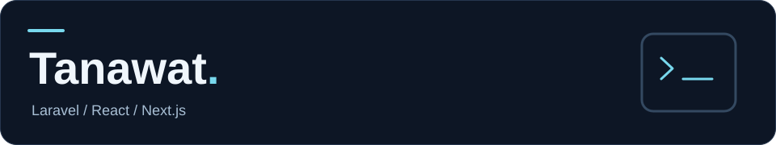
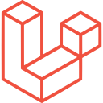
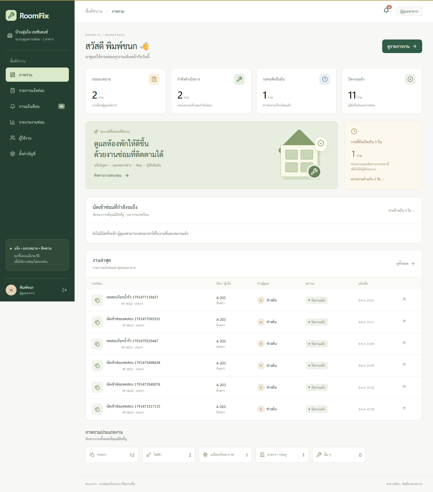
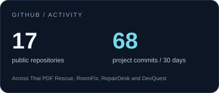
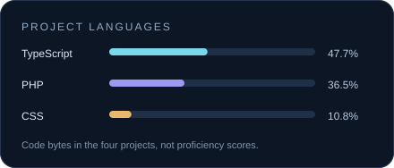

กำลังฝึกทำเว็บแบบ full-stack ผ่านโปรเจกต์ที่ลองใช้เอง แล้วค่อย ๆ ปรับจากสิ่งที่เจอระหว่างทำ

ช่วงนี้ทำทั้ง Laravel + React และ Next.js ตั้งแต่หน้าตาเว็บ ฐานข้อมูล ไปจนถึงการเขียน tests

### เครื่องมือที่ใช้

&nbsp;&nbsp;
&nbsp;&nbsp;
&nbsp;&nbsp;
&nbsp;&nbsp;
&nbsp;&nbsp;
&nbsp;&nbsp;

### โปรเจกต์ที่กำลังทำ

<table>
<tr><td width="50%" valign="top"><strong><a href="https://github.com/moses0100/thai-pdf-rescue">Thai PDF Rescue</a></strong>
ดึงข้อความ PDF ไทยและอ่านภาพสแกนด้วย OCR ในเบราว์เซอร์ ไม่ต้องอัปโหลดเอกสาร
Next.js · TypeScript · PDF.js · Tesseract.js</td>
<td width="50%" valign="top"><strong><a href="https://github.com/moses0100/roomfix">RoomFix</a></strong>
แจ้งซ่อม นัดช่าง และติดตามงาน แยกหน้าที่ของผู้พัก ผู้ดูแล และช่าง
Laravel · React · Inertia · PostgreSQL</td></tr>
<tr><td width="50%" valign="top"><strong><a href="https://github.com/moses0100/repairdesk">RepairDesk</a></strong>
ระบบรับซ่อมมือถือกับ POS ลองทำเรื่องสต็อก การรับเงิน และป้องกันบิลซ้ำ
Laravel · React · SQLite / PostgreSQL</td>
<td width="50%" valign="top"><strong><a href="https://github.com/moses0100/devquest">DevQuest</a></strong>
เก็บเป้าหมาย งานย่อย และบันทึกสิ่งที่เรียนรู้จากการฝึกเขียนโค้ด
Next.js · TypeScript · Prisma · PostgreSQL</td></tr>
</table>

หน้าภาพรวม RoomFix — ภาพจากข้อมูลเดโม ส่วนวิธีรันและข้อจำกัดอยู่ใน README ของแต่ละโปรเจกต์

### GitHub

ข้อมูล ณ 3 พฤศจิกายน 2026 · ยอด commits รวมผู้ร่วมพัฒนาใน repo ทั้ง 4 แห่ง · ไอคอนจาก <a href="https://github.com/devicons/devicon">Devicon</a>

<!-- Refresh local cards: node scripts/update-stats.mjs. Review and commit the changed SVGs manually. -->
